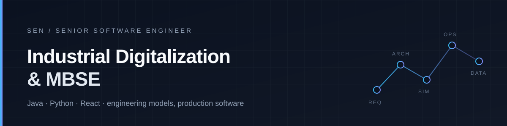

  

  <strong>Senior Software Engineer</strong> · Industrial Digitalization &amp; MBSE · Independent Developer

  
  
  
  

---

I build software for industrial digitalization and Model-Based Systems Engineering — the layer where requirements, architecture, simulation, and operations have to agree with each other.

Most of my work sits between two worlds: **engineering models** that describe how a system should behave, and **production software** that has to survive real users, real data, and real deadlines.

### What I focus on

- **MBSE tooling** — SysML-based modeling, requirements-to-architecture traceability, and workflows that make models useful beyond the diagram.
- **Industrial digital platforms** — data pipelines and integration layers that connect engineering, manufacturing, and operations.
- **Product engineering** — shipping full-stack applications end to end, usually Java or Python on the server and React on the front end.

### Toolbox

| | |
| :-- | :-- |
| **Languages** | Java · Python · TypeScript / JavaScript |
| **Front end** | React · modern web tooling |
| **Back end** | Java services · Python services · REST APIs |
| **Domain** | MBSE · SysML · requirements and architecture modeling · digital thread |
| **Interests** | developer tooling · automation · agentic AI for engineering workflows |

### Independent work

Alongside my professional work I design, build, and ship my own products. I like the full loop: choosing the problem, shaping the architecture, implementing it, releasing it, and doing the unglamorous maintenance that follows.

### Open-source contributions

I contribute bug fixes, integrations, and developer tooling improvements to open-source projects. Each link below points to the actual pull request.

**Merged contributions**

| Project | Contribution | Pull request |
| :-- | :-- | :-- |
| [Semantica](https://github.com/semantica-agi/semantica) | Preserve entities and relationships during Agno ingestion | [#2233](https://github.com/semantica-agi/semantica/pull/2233) |
| [Semantica](https://github.com/semantica-agi/semantica) | Instantiate rule conclusions using matched variable bindings | [#2234](https://github.com/semantica-agi/semantica/pull/2234) |
| [Dify Official Plugins](https://github.com/langgenius/dify-official-plugins) | Advertise structured-output support for OpenRouter JSON-schema models | [#4236](https://github.com/langgenius/dify-official-plugins/pull/4236) |
| [last30days](https://github.com/mvanhorn/last30days-skill) | Explain missing X browser cookies in diagnostics | [#1499](https://github.com/mvanhorn/last30days-skill/pull/1499) |
| [last30days](https://github.com/mvanhorn/last30days-skill) | Report partial Reddit archive access when discovery fails | [#1500](https://github.com/mvanhorn/last30days-skill/pull/1500) |

**Accepted contributions (cherry-picked)**

| Project | Contribution | Pull request / accepted commit |
| :-- | :-- | :-- |
| [Graphify](https://github.com/Graphify-Labs/graphify) | Fix call resolution through destructured CommonJS barrel requires; cherry-picked with authorship preserved and released in v0.9.105 | [#5104](https://github.com/Graphify-Labs/graphify/pull/5104) · [Accepted commit](https://github.com/Graphify-Labs/graphify/commit/bce80814d7983ec96b6c8fbd48838dc8740bf314) |

**Open pull requests**

| Project | Contributions | Pull requests |
| :-- | :-- | :-- |
| [Dify](https://github.com/langgenius/dify) | Knowledge settings persistence, Notion pagination, dataset refresh, multilingual keyword extraction, and batch trace configuration | [#45867](https://github.com/langgenius/dify/pull/45867), [#45868](https://github.com/langgenius/dify/pull/45868), [#45870](https://github.com/langgenius/dify/pull/45870), [#45871](https://github.com/langgenius/dify/pull/45871), [#45890](https://github.com/langgenius/dify/pull/45890) |
| [LoopForge](https://github.com/Tencent/LoopForge) | Bearer authentication for custom gateways and clearer credential configuration icons | [#904](https://github.com/Tencent/LoopForge/pull/904), [#926](https://github.com/Tencent/LoopForge/pull/926) |
| [Plannotator](https://github.com/backnotprop/plannotator) | Hide automatic WSL mount shortcuts, respect Codex provider authentication, and simplify project labels | [#3480](https://github.com/backnotprop/plannotator/pull/3480), [#3530](https://github.com/backnotprop/plannotator/pull/3530), [#3532](https://github.com/backnotprop/plannotator/pull/3532) |
| [AG-UI](https://github.com/ag-ui-protocol/ag-ui) | Update Python SDK development commands and directory references | [#3408](https://github.com/ag-ui-protocol/ag-ui/pull/3408) |
| [Memori](https://github.com/MemoriLabs/Memori) | Preserve caller-owned connections and allow new conversations after session timeouts | [#660](https://github.com/MemoriLabs/Memori/pull/660), [#661](https://github.com/MemoriLabs/Memori/pull/661) |
| [FastGPT](https://github.com/labring/FastGPT) | Expose dataset record creation timestamps with a fallback for legacy records | [#8302](https://github.com/labring/FastGPT/pull/8302) |
| [Canal](https://github.com/alibaba/canal) | Default instance mode to SPRING to prevent a startup null-pointer error | [#5629](https://github.com/alibaba/canal/pull/5629) |
| [LogicFlow](https://github.com/didi/LogicFlow) | Fix anchors, scrolling, drag events, edge movement, text measurement, and snapping | [#2430](https://github.com/didi/LogicFlow/pull/2430), [#2431](https://github.com/didi/LogicFlow/pull/2431), [#2432](https://github.com/didi/LogicFlow/pull/2432), [#2433](https://github.com/didi/LogicFlow/pull/2433), [#2435](https://github.com/didi/LogicFlow/pull/2435) |
| [CC Switch](https://github.com/farion1231/cc-switch) | Windows session restoration, disabled-thinking mapping, and removal of a redundant menu entry | [#9338](https://github.com/farion1231/cc-switch/pull/9338), [#9350](https://github.com/farion1231/cc-switch/pull/9350), [#9351](https://github.com/farion1231/cc-switch/pull/9351) |
| [text-to-cad](https://github.com/earthtojake/text-to-cad) | Document GLB visual assets and glTF validation guidance | [#811](https://github.com/earthtojake/text-to-cad/pull/811) |
| [Semantica](https://github.com/semantica-agi/semantica) | Improve integration documentation and reference links | [#2235](https://github.com/semantica-agi/semantica/pull/2235) |
| [Sure](https://github.com/we-promise/sure) | Preserve importer ownership and sharing for YNAB accounts | [#5132](https://github.com/we-promise/sure/pull/5132) |
| [Desktop Commander](https://github.com/wonderwhy-er/DesktopCommanderMCP) | Indicate when initial process output is truncated | [#1063](https://github.com/wonderwhy-er/DesktopCommanderMCP/pull/1063) |
| [eladmin](https://github.com/elunez/eladmin) | Handle missing User-Agent, decrypt RSA ciphertext by block, and reject cyclic menu parent chains | [#931](https://github.com/elunez/eladmin/pull/931), [#932](https://github.com/elunez/eladmin/pull/932), [#933](https://github.com/elunez/eladmin/pull/933) |
| [neovis.js](https://github.com/neo4j-contrib/neovis.js) | Preserve null fields in serialized data records | [#393](https://github.com/neo4j-contrib/neovis.js/pull/393) |
| [Apache HertzBeat](https://github.com/apache/hertzbeat) | Split oversized WeCom Markdown alerts | [#4566](https://github.com/apache/hertzbeat/pull/4566) |
| [Spring AI Extensions](https://github.com/spring-ai-alibaba/spring-ai-extensions) | Preserve DashScope chat options when copying | [#305](https://github.com/spring-ai-alibaba/spring-ai-extensions/pull/305) |
| [Modern Web Guidance](https://github.com/GoogleChrome/modern-web-guidance-src) | Omit unavailable CLI entries from GitHub distributions | [#3623](https://github.com/GoogleChrome/modern-web-guidance-src/pull/3623) |
| [Stitch Skills](https://github.com/google-labs-code/stitch-skills) | Resolve the uploader from the installed Stitch plugin | [#97](https://github.com/google-labs-code/stitch-skills/pull/97) |
| [Anthropic Skills](https://github.com/anthropics/skills) | Fix PresentationML comment identity validation | [#2229](https://github.com/anthropics/skills/pull/2229) |

Status checked on November 18, 2026. [All pull requests](https://github.com/pulls?q=is%3Apr+author%3Aqq2514568380) · [Merged pull requests](https://github.com/pulls?q=is%3Apr+author%3Aqq2514568380+is%3Amerged)

### When I'm not writing code

**Counter-Strike 2** — Faceit Level 10. The interesting part is the same as engineering: read the information, make a decision, and live with it under time pressure.

### Elsewhere

The best way to reach me is here on GitHub — open an issue or start a discussion in one of my repositories.
