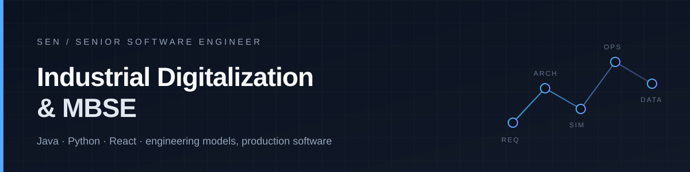

  

  <strong>Senior Software Engineer</strong> · Industrial Digitalization &amp; MBSE · Independent Developer

  
  
  
  

---

I build software for industrial digitalization and Model-Based Systems Engineering — the layer where requirements, architecture, simulation, and operations have to agree with each other.

Most of my work sits between two worlds: **engineering models** that describe how a system should behave, and **production software** that has to survive real users, real data, and real deadlines.

### What I focus on

- **MBSE tooling** — SysML-based modeling, requirements-to-architecture traceability, and workflows that make models useful beyond the diagram.
- **Industrial digital platforms** — data pipelines and integration layers that connect engineering, manufacturing, and operations.
- **Product engineering** — shipping full-stack applications end to end, usually Java or Python on the server and React on the front end.

### Toolbox

| | |
| :-- | :-- |
| **Languages** | Java · Python · TypeScript / JavaScript |
| **Front end** | React · modern web tooling |
| **Back end** | Java services · Python services · REST APIs |
| **Domain** | MBSE · SysML · requirements and architecture modeling · digital thread |
| **Interests** | developer tooling · automation · agentic AI for engineering workflows |

### Independent work

Outside my day job I design, build, and ship my own products. I like the full loop: choosing the problem, shaping the architecture, implementing it, releasing it, and doing the unglamorous maintenance that follows.

### When I'm not writing code

**Counter-Strike 2** — Faceit Level 10. The interesting part is the same as engineering: read the information, make a decision, and live with it under time pressure.

### Elsewhere

The best way to reach me is here on GitHub — open an issue or start a discussion in one of my repositories.
